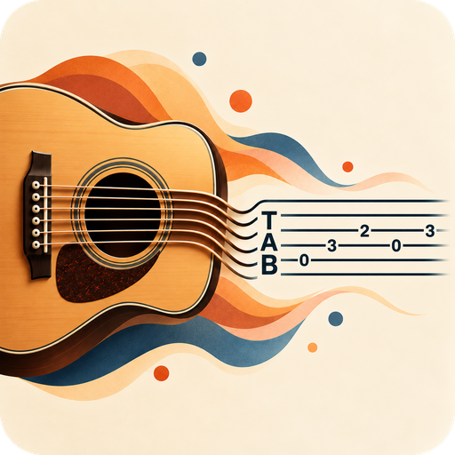
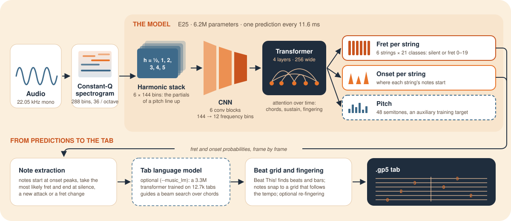

<p align="center"></p>

<h1 align="center">Guitab</h1>

<p align="center"><b>Guitar audio → Guitar Pro tab</b></p>

Guitab turns a recording of a solo guitar into a tab you can open in Guitar Pro, TuxGuitar, MuseScore or any online gp5 player. It is made for **steel-string fingerstyle** playing, works on *any recording you can play* (a phone video is fine), and runs on a laptop: a 4-minute song takes well under a minute.

You get a `.gp5` file with the notes on the right strings and frets, laid out on a grid that follows the beats of the recording, with an optional capo. A **local web app** lets you record or load a song, transcribe it and play the tab back, and a **[browser version](https://danielemorotti.github.io/guitab/)** does the same with nothing to install.

**What to expect.** On clean recordings about 85% of the notes come out right, with the correct string and fret. Dense 3–4 note chords, quiet inner voices and phone recordings in a reverberant room are much harder. Treat the result as *a first draft to correct by ear*, not as a finished tab.

**What's new in 1.2** (2026-10-31): chord names above the tab, from a small chord model (0.5 MB) that reads the transcribed notes: about 3 in 4 shown chords are right on real fingerstyle songs and 9 in 10 on strummed accompaniment, and chords the model is unsure of are left out. A Chords switch shows or hides them, in the local app and in the browser. All versions are in the [changelog](CHANGELOG.md).

## Results

| Test set | Metric (onset ±50 ms) | E15 (public data) | E19 (+ custom dataset) | E25 (default) | E24 (tiny) |
|---|---|---|---|---|---|
| GuitarSet test (player 05, steel string) | string + fret F1 / pitch F1 | 0.836 / 0.866 | 0.843 / 0.866 | 0.838 / 0.861 | 0.833 / 0.856 |
| GuitarSet test, phone/room-degraded copy | string + fret F1 / pitch F1 | 0.650 / 0.735 | 0.640 / 0.721 | 0.685 / 0.757 | 0.655 / 0.737 |
| GAPS test (classical guitar, unseen players and rooms) | pitch F1 | 0.827 | 0.813 | 0.830 | 0.825 |
| Real fingerstyle recordings (19 held-out songs of the custom dataset) | string + fret F1 | 0.548 | 0.617 | 0.612 | 0.601 |
| EGDB electric guitar test (25 clips, clean DI, never seen in training) | string + fret F1 / pitch F1 | 0.636 / 0.833 | 0.712 / 0.850 | 0.721 / 0.849 | 0.691 / 0.830 |
| EGDB electric guitar test, through two amps (clean and crunch) | string + fret F1 / pitch F1 | 0.613 / 0.784 | 0.631 / 0.787 | 0.652 / 0.788 | 0.622 / 0.781 |

- **E25 (default)** is a 6M-parameter model, a quarter of E19's size, trained to imitate the average of E19 and the 66M-parameter E18 (distillation). It is within a point of E19 on clean steel-string audio, clearly better on phone recordings and classical guitar, and 1.5x faster.
- **E24 (tiny)** follows the same recipe at half the size: 2.9M parameters, an 11 MB file, 2.3x faster than E19 and about one point behind it on GuitarSet.
- **E19** is the strongest model trained on the labels alone. Besides the public datasets it used a custom dataset of real fingerstyle recordings with aligned tabs, which is not distributed.
- **E15** is trained on public datasets only, and anyone can reproduce it with the commands in section 4.

**Electric guitar.** The models never saw an electric guitar during training, but they also work on clean or lightly overdriven ones. On the [EGDB](https://ss12f32v.github.io/Guitar-Transcription/) test set (Chen et al., ICASSP 2022) the notes are found almost as well as on acoustic recordings, while the string choice is less reliable, so expect more fingering corrections. Heavy distortion was not tested.

The whole research history, with every experiment, setting and result (including the approaches that did not work), is in [`EXPERIMENTS.md`](EXPERIMENTS.md).

## 1. Install

From the repository root, with Python 3.11, on macOS, Linux or Windows:

```bash
uv venv .venv --python 3.11
uv pip install --python .venv/bin/python -r requirements.txt   # exact tested versions
uv pip install --python .venv/bin/python -e . --no-deps          # the `guitab` command
```

`pip install -e ".[train]"` works too; `requirements.txt` pins the environment the results were produced with. On Linux the default PyTorch wheel includes CUDA; for another CUDA version or a CPU-only build, install `torch` first as described on [pytorch.org](https://pytorch.org/get-started/locally/). On Windows, the commands below use `.venv\Scripts\` instead of `.venv/bin/`.

Every command takes `--device auto|cuda|mps|cpu`. The default, `auto`, uses an NVIDIA GPU if present, else the Apple GPU, else the CPU.

**ffmpeg is optional.** WAV, FLAC, OGG, MP3 and AIFF files are read without it. The `guitab` command needs [ffmpeg](https://ffmpeg.org) only for other formats, such as videos or M4A files (`brew install ffmpeg` on macOS, `apt install ffmpeg` on Debian or Ubuntu). The web app decodes those in the browser and needs no ffmpeg. Training needs ffmpeg for its audio augmentation and the GAPS download.

### Model weights

The weights are on Hugging Face at [danmor/guitab](https://huggingface.co/danmor/guitab):

| File | Model | Size |
|---|---|---|
| `guitab_e25.safetensors` | E25, the default | 24 MB |
| `guitab_e24.safetensors` | E24, the tiny model | 11 MB |
| `guitab_e19.safetensors` | E19 | 91 MB |
| `tablm.safetensors` | the tab language model behind `--music_lm` | 13 MB |
| `beat_this_small0_int8.onnx` | the [Beat This!](https://github.com/CPJKU/beat_this) beat tracker (small model) with int8 weights, shared with the browser version | 3.6 MB |
| `beat_this_final0_int8.onnx` | the larger Beat This! model, used only if you select it (below) | 21 MB |
| `chord_model.safetensors` | the chord model behind the chord names (`EXPERIMENTS.md`, C1) | 0.5 MB |

**Nothing to do by hand:** the commands and the web app download the files they need into `weights/` the first time they need them (each first download of a tab model is counted on the Hugging Face page, through a request for its small `config.json`; nothing else is sent) (E25, the beat tracker and the chord model for the first transcription, the language model with `--music_lm`, another model when you pass its path). To get all of them at once, for example to work offline, download them from the Hugging Face page or with:

```bash
uv pip install --python .venv/bin/python huggingface_hub
.venv/bin/hf download danmor/guitab --local-dir weights
```

`guitab` uses **E25**. Pass `--checkpoint` to use another model, e.g. `--checkpoint weights/guitab_e19.safetensors`. A model you train yourself (`runs/<run>/best.pt`) takes precedence over the downloaded file, and if you train only E15 (section 4) it becomes the default; every command reads both formats, and `scripts/export_weights.py` writes the published `.safetensors` files from your own checkpoints. The beat tracker is set by `BEAT_MODEL` in `guitab/paths.py`: `small0` (the default) or `final0`, 6 times larger and about 3 points better on the rhythm of steady-tempo songs, the same on free-tempo ones (`EXPERIMENTS.md`, B1); `scripts/export_web.py` exports the same one for the browser. If its `.onnx` file cannot be downloaded, the beats come from the PyTorch Beat This! model (from `data/models/`, else downloaded by the Beat This! package), whose results are close but not identical to the browser version's.

## 2. Transcribe a recording

```bash
.venv/bin/guitab --audio my_song.mp3 --out_dir out/my_song      # wav, flac, ogg, mp3, aiff
.venv/bin/guitab --audio my_video.mov --out_dir out/my_video    # videos and other formats, with ffmpeg installed
```

The result is `out/my_song/my_song.gp5`, named after the audio file, plus `my_song.tokens.txt` with the same tab as text tokens. A 4-minute song takes well under a minute and 1–2 GB of GPU memory.

| Option | Effect |
|---|---|
| `--capo 3` | The song is played with a capo at that fret: notes stay on strings that can play them, frets are written relative to the capo, and the .gp5 has the capo set. |
| `--music_lm` | Fuller chords: the notes are decoded together with a small tab language model trained on symbolic tabs. 3–4 note chords come out more complete, overall accuracy changes by about ±1 point, and it is 10–20 s slower. |
| `--onset 0.4` | Keep less confident notes: more notes, and more false ones. The default is the model's own (0.45 for E25, 0.5 for E24, 0.6 for the others); try 0.1 below it if notes are missing. |
| `--orphan` | Also keep notes without a detected attack (quiet or sustained notes). |
| `--fingering low` | Re-finger towards first position with a Viterbi optimiser. The default, `model`, keeps the model's strings; `auto` re-fingers only clearly awkward shapes. |
| `--tempo 90` | A fixed tempo instead of following the detected beats. |
| `--grid 120` | Quantisation grid in ticks (960 = quarter note): 240 = 16ths (default), 120 = 32nds. |
| `--no_chords` | No chord names above the tab. By default a small chord model names the chords where it is confident (about 3 in 4 right on real fingerstyle songs); without its weights or a connection for the first download, the tab simply has none. |
| `--checkpoint PATH` | Another model. |
| `--name X` | The output file name. |
| `--params JSON` | Note-extraction settings (`DEFAULT_PARAMS` in `guitab/inference.py`), e.g. `'{"legato": 5}'`. |
| `--music_lm_weight 0.3` / `--music_lm_bonus 1.0` | Language-model weight and per-note bonus (higher = fuller chords, more false notes). |

### Web app

```bash
.venv/bin/guitab-app          # opens http://127.0.0.1:8765 in the browser
```

Load an audio or video file (the browser decodes it), or record from the microphone. On the first launch the app downloads E25 if no model is in `runs/` or `weights/`. Choose the model (any checkpoint present among E25, E19, E24, E15, E18 and E20; E19 and E24 appear once they are in `weights/`), the capo, fuller chords, the note sensitivity (it starts at the model's own default), the fingering, the tempo and the grid, then press **Transcribe**.

The tab appears in an [alphaTab](https://www.alphatab.net) viewer with playback: play and pause (space), click a note to play from there, speed, metronome, count-in, loop, tab only or notation and tab, zoom, and download of the .gp5. Any existing .gp5 file can be opened too.

Every result is kept in `out/app/` and listed under *Tabs*. The server only listens on this computer; the viewer is loaded from a CDN, so the page needs internet.

### Browser version (no Python, no server)

`docs/` is a static page that does the whole transcription in the browser, so *the audio never leaves the device*. The models run with [ONNX Runtime Web](https://onnxruntime.ai) (WebGPU when the browser has it, else WebAssembly), and the rest of the pipeline (constant-Q spectrogram, note extraction, beat grid, fingering, .gp5 writer) is ported to JavaScript in `docs/js/`. It gives the same .gp5 as the Python pipeline, **byte for byte**: both use the same models and beat tracker, checked on four recordings (fingerstyle, classical, electric) at 22.05 kHz. Audio at other sample rates is resampled by the browser instead of librosa, so its results are close but not identical.

**Try it at [danielemorotti.github.io/guitab](https://danielemorotti.github.io/guitab/).** It offers E25 (20 MB), E19 (84 MB) and the tiny E24 (9 MB), plus the 3.6 MB beat tracker and the 0.5 MB chord model. The selected model is downloaded from Hugging Face the first time you transcribe with it, and the browser keeps it for later visits.

To run it locally (a page served from this computer reads the models from `docs/models/` instead of Hugging Face):

```bash
.venv/bin/python scripts/export_web.py      # docs/models/*.onnx, docs/models.json, docs/assets/dsp.json (pip install -e '.[web]')
python3 -m http.server 8800 -d docs         # then open http://127.0.0.1:8800
```

Compared with the local app there is **no fuller-chords option**: the tab language model would be quite slow in the browser, so it is only in the local web app. The beat tracker runs on WebAssembly, and the tabs are kept in the browser (IndexedDB). A 2:23 song takes about 16 s. Audio and video files are decoded by the browser itself (WAV, MP3, FLAC, OGG, M4A, and the audio track of MP4 / MOV / WebM videos in Chrome, Edge and Safari). `?backend=wasm` in the URL turns WebGPU off.

It is published with GitHub Pages (Settings → Pages → deploy from the `docs/` folder of `main`). The .onnx files stay out of git: `docs/models.json` points at the Hugging Face repository (`export_web.py --base`), where the files of `docs/models/` are uploaded next to the .safetensors weights.

## 3. Architecture

<p align="center"></p>

1. **Features** (`guitab/audio.py`): the audio, at 22.05 kHz mono, becomes a constant-Q spectrogram with 36 bins per octave over 8 octaves, one frame every 11.6 ms.
2. **Harmonic stack** (`guitab/model.py`): six shifted copies of the spectrogram (harmonics ½, 1, 2, 3, 4, 5) are stacked as channels, so the partials of a pitch line up and a convolution sees a note's whole harmonic pattern at once.
3. **CNN**: six convolution blocks (64, 128, 256 channels) keep the time resolution and pool the 144 frequency bins down to 12.
4. **Transformer**: attention over time gives each frame the context of the surrounding seconds, which decides chords, sustained notes and the choice of string. The size sets the depth: `small` (E25, 4 layers, 256 wide, 6.2M parameters), `half` (E24, 2.9M), `mid` (E19, 6 layers, 512 wide, 24M) and `large` (66M).
5. **Heads**: for every frame and string, the fret (21 classes: silent or frets 0–19) and the onset probability, plus a 48-semitone pitch head used only as an extra training target.
6. **Note extraction** (`guitab/inference.py`): notes start at onset peaks, take the most likely fret, and end at silence, at a new attack or at a fret change (legato). The same pitch on two strings at once is kept once, an attack that splits a ringing note is merged back, and with a capo the notes below it move to a playable string.
7. **Optional chord decoding** (`guitab/tablm.py`, `--music_lm`): a beam search over candidate chords, scored by the acoustic model and by a 3.3M-parameter transformer trained on about 12.7k symbolic guitar tabs.
8. **Tab** (`guitab/beats.py`, `guitab/tab.py`, `guitab/fingering.py`, `guitab/gp5.py`): the beats come from the Beat This! activation together with the model's own onset probabilities, tracked by dynamic programming, so they stay regular but follow the tempo when the player speeds up or slows down; the bar length and the first bar come from the downbeat activation. Then quantisation to a grid that follows those beats, optional re-fingering, and Guitar Pro 5 output.

9. **Chord names** (`guitab/chords.py`): per eighth note of the beat grid, the transcribed notes become pitch-class features (sounding notes, attacks, bass, open strings, low register, top note). A 135k-parameter model scores the chords with the same small network and bidirectional GRU for each of the 12 possible roots, so it learns harmony once for all keys. A Viterbi decoding with chord-to-chord statistics from Chordonomicon picks the sequence, and a chord is shown only where the model is confident.

E25 and E24 are trained by distillation: the small student learns from the labels and, with equal weight, from the averaged predictions of the larger E18 and E19.

## 4. Training

All commands run from the repository root.

### 4.1 Data (one-off)

**GuitarSet** (CC BY 4.0, [Zenodo 3371780](https://zenodo.org/records/3371780)): download `annotation.zip` and `audio_mono-mic.zip`, unzip them into `data/guitarset/annotation/` and `data/guitarset/audio_mic/`, then run:

```bash
.venv/bin/python scripts/prepare_guitarset.py     # track list (players 00-03 train, 04 validation, 05 test)
.venv/bin/python scripts/guitarset_shift.py       # +1/+2 semitone copies of the training players
```

**GAPS** (classical guitar, CC BY-NC-SA 4.0, [Zenodo 13962272](https://zenodo.org/records/13962272)):

```bash
mkdir -p data/gaps && curl -L -o data/gaps/gaps_v1_no_audio.zip \
  "https://zenodo.org/records/13962272/files/gaps_v1_no_audio.zip?download=1"
(cd data/gaps && unzip -o gaps_v1_no_audio.zip "gaps_v1/*.csv")   # only the csv files: see the note below
.venv/bin/python scripts/gaps_extract.py          # MIDI / MusicXML with case-safe file names
.venv/bin/python scripts/gaps_download.py         # audio from the dataset's YouTube links; run twice to retry errors
.venv/bin/python scripts/gaps_labels.py           # string/fret labels from the score's tab staff, aligned to the MIDI
```

> GAPS ids differ only by letter case (`GM1wc` ≠ `gM1wc`), so a plain unzip on a case-insensitive file system overwrites files. Always extract with `scripts/gaps_extract.py`.

**SynthTab subset** (tabs rendered with sampled guitars, CC BY-NC 4.0, [SynthTab](https://github.com/AirLabUR/SynthTab)): 428 selected fingerstyle songs (about 21 h, 5.3 GB of audio and 1.1 GB of labels), fetched with HTTP range requests from the 2 TB dataset:

```bash
.venv/bin/python scripts/synthtab_fetch.py labels     # label archive
.venv/bin/python scripts/synthtab_fetch.py download   # the songs in data/synthtab/selection.csv (versioned)
```

**Custom dataset** (not distributed): real fingerstyle recordings with their tabs aligned to the audio. It is used by E17–E19, and through E19 by the distilled E24 and E25. The tools that built it are not published; `guitab/custom_data.py` documents the layout that training reads from `data/custom/`.

**Feature caches**:

```bash
.venv/bin/python scripts/build_cache.py --workers 4                    # CQT + frame labels (~10 min, 2.6 GB)
.venv/bin/python scripts/build_aug_cache.py --copies 2 --close --workers 4   # augmented training copies (phone/room, close mic)
.venv/bin/python scripts/build_aug_cache.py --degraded --workers 4     # held-out degraded copies for robustness tests
```

### 4.2 Train

The exact command lines of every training run are in `experiments/` (E8 to E25, described in EXPERIMENTS.md).

The public-data model E15 is trained in three stages, each after the previous one has finished (about 5 h, 3 h and 2 h on an Apple M3 Pro laptop):

```bash
experiments/train_mid_gaps.sh     > runs/tabmodel_mid_gaps.log 2>&1       # E10: GuitarSet + GAPS, from scratch
experiments/train_mid_gaps_aug.sh > runs/tabmodel_mid_gaps_aug.log 2>&1   # E12: + phone/room audio augmentation
experiments/train_mid_close.sh    > runs/tabmodel_mid_close.log 2>&1     # E15: + SynthTab, close-mic augmentation
grep EVAL runs/tabmodel_mid_close.log                                   # validation every 1000 steps
.venv/bin/python scripts/train_tablm.py corpus && .venv/bin/python scripts/train_tablm.py train   # tab LM for --music_lm
```

E25 needs the custom dataset. Train E18 (`experiments/train_large_all.sh`) and E19 (`experiments/train_mid_all.sh`), then distil them into the small model, which takes about 11 h because the teachers run on every batch:

```bash
SIZE=small experiments/train_distill.sh > runs/tabmodel_small_distill.log 2>&1   # E25 (SIZE=half: E24, 2.9M)
```

Distilled models are under-confident on note attacks. Pick their onset threshold on validation and store it in the checkpoint as `"decoding": {"onset": 0.45}`; every command and the web app apply it.

- `scripts/train.py` options: `--device`, `--max_memory`, `--size half|small|mid|large`, `--steps`, `--batch`, `--lr` and `--accum` (gradient accumulation); the data shares `--gaps_share`, `--synth_share` and `--ss_share` (custom dataset) with their string-label weights `--*_tab_weight`; audio augmentation with `--aug_copies` and `--aug_share`; `--init` (fine-tune from a checkpoint); `--eval_degraded`; `--teacher` (repeatable) and `--distill` (distillation weight).
- The launchers cap GPU memory (`--max_memory 0.35`, a fraction of the GPU memory) and run at low priority, so the machine stays usable. `DEVICE=cuda experiments/...` picks the device.
- Re-running a launcher resumes from `last.pt`, and `STOP_AT=18:30 experiments/...` stops at the first evaluation after 18:30.
- The outputs go to `runs/<name>/`: `best.pt` (best validation score), `last.pt` (for resuming) and `log.jsonl`.

The chord model (about 70 min on a laptop CPU) needs [Chordonomicon](https://huggingface.co/datasets/ailsntua/Chordonomicon) in `data/chordonomicon/` and, for its real training and evaluation songs, the custom dataset and EGDB. The first run is trained without self-labelled recordings; its weights then label them for the second (`EXPERIMENTS.md`, C1):

```bash
.venv/bin/python scripts/build_chord_data.py                                     # data/chords/: progressions, voicings, tabs, GuitarSet, evaluation songs
.venv/bin/python scripts/train_chords.py --out runs/chords_run1 --pseudo_share 0 --synth_share 0.6 --tab_share 0.15
.venv/bin/python scripts/build_chord_data.py --pseudo runs/chords_run1/best.safetensors   # self-labelled recordings
.venv/bin/python scripts/train_chords.py --out runs/chords                       # the published model
.venv/bin/python scripts/evaluate_chords.py                                      # held-out GuitarSet and custom-dataset songs
```

## 5. Evaluation

```bash
.venv/bin/python scripts/evaluate.py --checkpoint runs/tabmodel_mid_close/best.pt --split test             # GuitarSet test
.venv/bin/python scripts/evaluate.py --checkpoint runs/tabmodel_mid_close/best.pt --split test --variant deg   # degraded copy
.venv/bin/python scripts/evaluate.py --checkpoint runs/tabmodel_mid_close/best.pt --split validation --tune   # threshold search
.venv/bin/python scripts/evaluate_gaps.py --checkpoints runs/tabmodel_mid_close/best.pt                    # GAPS test
.venv/bin/python scripts/sweep.py --checkpoint runs/tabmodel_mid_close/best.pt --out runs/sweep.json       # P/R sweep + frame metrics
.venv/bin/python scripts/evaluate_beats.py --splits test,gaps_test                                         # beat grid: rhythm, beats, downbeats
```

- Choose checkpoints and settings on validation only (GuitarSet player 04, GAPS validation), and report the test sets once per model.
- GuitarSet is scored on the fixed 15 s chunks of `data/eval_chunks.json`, frozen so that results stay comparable.
- `scripts/analyze_errors.py` breaks the errors down by category, and `scripts/evaluate_song.py` is the private benchmark on the author's own recording.

## 6. Repository layout

```
guitab/            the library: audio, model, inference, tablm, beats, chords, tab, fingering, gp5, pipeline, cli, app (+ web/),
                   device, data, augment, chord_data, guitarset, gaps, synthtab, custom_data, evaluation, paths
scripts/           command-line tools: data preparation, caches, training, evaluation
experiments/       exact launchers of the training runs (see EXPERIMENTS.md)
assets/            the logo and the architecture diagram
data/              datasets and caches (not versioned except eval_chunks.json and the subset selections)
runs/              trained checkpoints and logs (not versioned)
weights/           the published weights downloaded from Hugging Face (not versioned)
out/               transcriptions (not versioned)
```

## Licence and credits

The code is MIT licensed (see `LICENSE`). The datasets keep their own licences: GuitarSet CC BY 4.0, GAPS CC BY-NC-SA 4.0, SynthTab CC BY-NC 4.0. The models are trained on them and inherit their non-commercial terms, so the published weights are **CC BY-NC-SA 4.0**, for research and personal use. The beat tracker shared on Hugging Face is a converted copy of Beat This! and keeps its MIT licence.

Guitab builds on:

- **Datasets:** [GuitarSet](https://zenodo.org/records/3371780) (Xi et al., 2018), [GAPS](https://zenodo.org/records/13962272) (Riley et al., 2024), [SynthTab](https://github.com/AirLabUR/SynthTab) (Zang et al., 2024), and [EGDB](https://ss12f32v.github.io/Guitar-Transcription/) (Chen et al., 2022) for the electric-guitar check.
- **Ideas:** the constant-Q transform (Brown, 1991); the harmonic constant-Q stack (Bittner et al., "Deep salience representations for F0 estimation in polyphonic music", ISMIR 2017), built here, as in [Basic Pitch](https://github.com/spotify/basic-pitch) (Bittner et al., ICASSP 2022), by shifting one CQT; separate onset and frame predictions as in Onsets and Frames (Hawthorne et al., ISMIR 2018); one fret classifier per string, as in TabCNN (Wiggins and Kim, ISMIR 2019).
- **Software:** [Beat This!](https://github.com/CPJKU/beat_this) for the beats (Foscarin et al., ISMIR 2024), [librosa](https://librosa.org) for the spectrogram, which the browser version ports to JavaScript, [PyGuitarPro](https://github.com/Perlence/PyGuitarPro) for the .gp5 files, [ONNX Runtime Web](https://onnxruntime.ai) and [alphaTab](https://www.alphatab.net) for the browser.
- **Starting point:** the research started from [Audio2Tab](https://github.com/JackJamesLoth/Audio2Tab), whose schedule the GuitarSet evaluation chunks follow.
